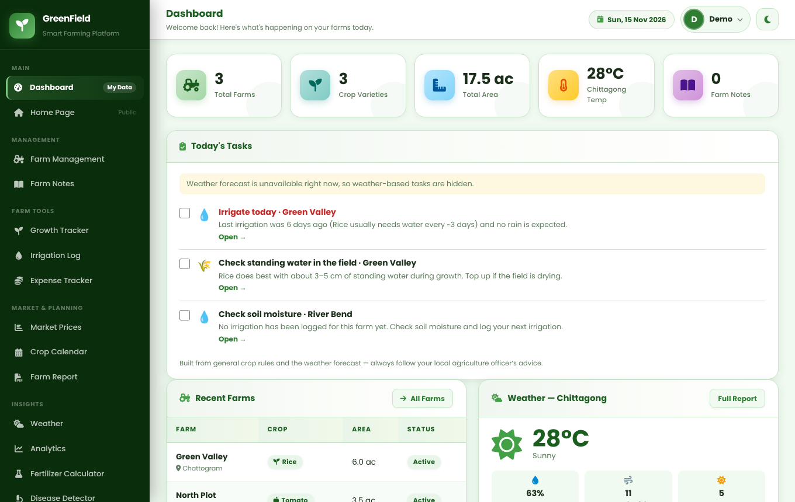
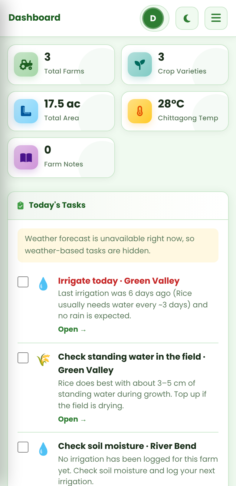
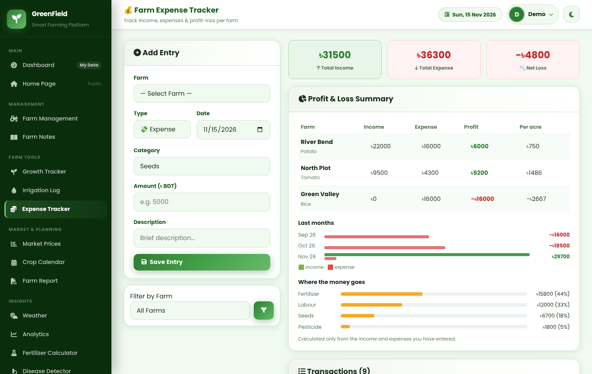
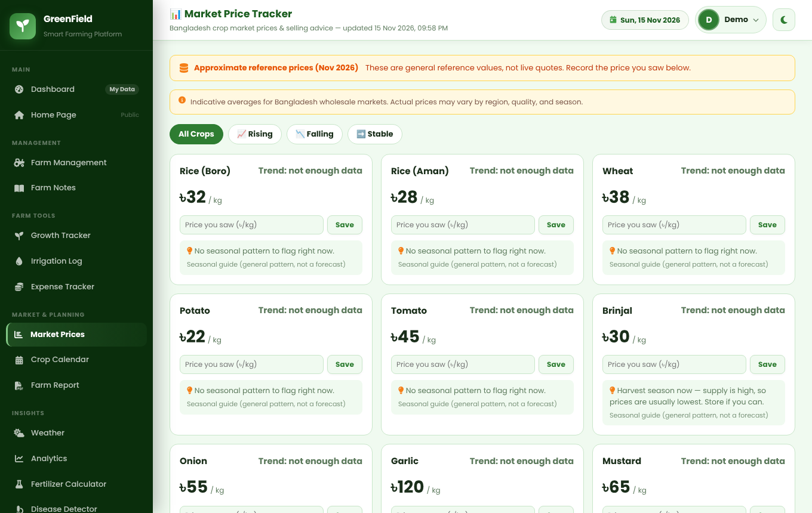

# 🌱 GreenField Smart Farming

A full-stack smart farming web application designed to help farmers manage farms, track crop-related activities, monitor weather, calculate fertilizer requirements, and analyze farm data from any device.

**Live Demo:** https://greenfield-smart-farming-1.onrender.com

**GitHub Repository:** https://github.com/abdurrahmancce/greenfield-smart-farming

[](https://github.com/abdurrahmancce/greenfield-smart-farming/actions/workflows/ci.yml)
  

> Screenshots below use demo data, not a real farmer's records.

| Dashboard + Today's Tasks | Mobile (installable PWA) |
| --- | --- |
|  |  |

| Expenses & profit/loss | Market prices (record what you saw) |
| --- | --- |
|  |  |

| Farm report (print / save as PDF) | Crop disease detector |
| --- | --- |
|  |  |

## 🚀 Highlights

* **Today's Tasks** - rule-based, crop-aware to-do list (irrigation, top-dressing, harvest window, fungal risk, rain/heat alerts) built from general Bangladesh crop guidance and the OpenWeather forecast. It says when the forecast is unavailable instead of guessing.
* **Push alerts** - Web Push (VAPID) notifications for rain, heat, fungal-risk and harvest alerts, sent by a GitHub Actions job every 3 hours; de-duplicated per day; one-tap test alert.
* **AI crop-disease photo check** - Gemini vision with a two-model cross-check, multi-photo scans and deliberately humble confidence labels. It is a hint, not a diagnosis (see limitations).
* **Money tracking** - income/expense log with per-farm profit & loss, monthly trend and cost breakdown.
* **Market prices you can trust** - labelled reference values plus prices *you* record; trends are shown only when there is enough real data.
* **Farm report** - totals, per-farm P&L and today's outlook, printable / save as PDF; full **data export** of your account.
* **Works without signal** - expenses and irrigation entered offline are saved on the phone and sent automatically when the connection returns (no duplicates).
* **Downloads** - CSV (Excel-safe) for expenses, irrigation and farms, plus an English PDF report.
* **Push alerts** - rain/heat/fungal risk, harvest approaching/ready, irrigation due or not needed.
* **Admin overview** - user and feature-usage numbers only, visible just to the e-mail(s) in `ADMIN_EMAILS`.
* **Bangla + English** UI, dark mode, installable offline-friendly PWA.
* **Engineering** - CSRF (Origin/Referer) protection, login throttling, hashed one-time reset tokens, other devices signed out on password change, security headers; pytest suite run by GitHub Actions on every push; nightly encrypted PostgreSQL backup (age public key or a 24+ character GPG passphrase) kept as a workflow artifact for 14 days, failing loudly when it cannot run; keep-alive workflow for the free hosting tier.

## ⚠️ Honest limitations

* The disease detector is an AI guess. Measured with `tools/eval_disease.py` on PlantVillage lab photos (`eval-results.txt`): **64% correct on the 67 photos that got an answer (43/67; 53 more failed because of the free AI quota)**. It was also over-confident: answers shown as 80-100% were right only 71% of the time, 60-79% right 67%, below 60% right 17%. Tomato leaf mold, bacterial spot and Septoria were the weakest. Real field photos will do worse than lab photos, and a repeat run can answer differently - always confirm with a local agriculture officer.
* Market prices are not live: the government source (DAM) publishes daily prices only as downloadable files, so the app shows approximate reference values and the prices users record themselves.
* Task rules are general guidance, not field-specific advice.
* Free hosting sleeps when idle (first load can take ~30-50 s); the keep-alive job reduces this.
* The nightly backup runs, but restoring from it has not been tested yet.
* The server-made PDF report is English-only (Bangla needs a shaping font); the browser's print / save-as-PDF on the Farm Report page handles Bangla. CSV files open correctly in Excel with Bangla text.
* Offline entries (expenses / irrigation) are kept in the phone's browser storage until they sync; clearing the browser's site data before they sync deletes them.

---

## 📌 Overview

GreenField Smart Farming is a multi-user web application built with **Python Flask, PostgreSQL, JavaScript, and Chart.js**.

The system provides a centralized platform for managing farm information, recording crop notes, checking weather conditions, calculating NPK fertilizer requirements, and viewing farm analytics.

The application is designed to work across desktop and mobile devices and can also be installed as a **Progressive Web App (PWA)**.

---

## 🎯 Problem

Farmers often need to manage different types of information separately, such as:

* Farm and crop information
* Farming notes and activities
* Weather conditions
* Fertilizer calculations
* Historical farm data
* Farm performance and analytics

GreenField brings these functions together in one web application.

---

## ✨ Key Features

### 🔐 User Authentication

* User registration and login
* Secure password hashing
* Session-based authentication
* Protected application routes
* Logout functionality
* Forgot password system
* Token-based password reset
* One-hour password reset token expiry

### 🌾 Farm Management

* Add new farms
* Edit existing farm information
* Delete farms
* Store farm-specific information
* User-based data isolation

### 📝 Farm Notes

Users can create and manage farming notes using different categories.

* Create notes
* Edit notes
* Delete notes
* Category-based organization
* Farm-specific records

### 🌦️ Weather Information

GreenField integrates the **OpenWeather API** to provide weather information.

Features include:

* Current weather information
* Forecast data
* Temperature
* Humidity
* Wind information
* Weather conditions
* Fallback data when the external API is unavailable

### 📊 Farm Analytics

The analytics dashboard uses **Chart.js** to visualize farming data.

It provides interactive charts for understanding farm-related information and activity.

### 🧪 Fertilizer Calculator

The fertilizer module helps calculate fertilizer requirements based on **N-P-K values**.

Features:

* Nitrogen calculation
* Phosphorus calculation
* Potassium calculation
* Calculation history
* Persistent database storage

### 📍 Farm Location

Farm locations can be selected and displayed using:

* Leaflet.js
* OpenStreetMap
* Nominatim geocoding

This allows users to associate their farms with real geographic locations.

### 👤 User Profile

Users can manage their profile information.

* View profile
* Update profile information
* Manage personal details

### 🌙 Dark Mode

The application includes a dark mode interface.

The selected theme is stored using `localStorage`, allowing the preference to remain after refreshing or reopening the application.

### 📱 Progressive Web App

GreenField supports PWA functionality.

Users can:

* Install the application on supported devices
* Add it to the mobile home screen
* Use cached resources when offline
* Access the application through a standalone app-like interface

---

## 🛠️ Technology Stack

| Category             | Technology                       |
| -------------------- | -------------------------------- |
| Backend              | Python, Flask                    |
| Database             | PostgreSQL                       |
| Development Database | SQLite                           |
| Frontend             | HTML5, CSS3, JavaScript          |
| Charts               | Chart.js                         |
| Weather API          | OpenWeather API                  |
| Maps                 | Leaflet.js                       |
| Geocoding            | Nominatim                        |
| Authentication       | Flask Sessions, Werkzeug, Google OAuth (Authlib) |
| AI                   | Google Gemini vision API         |
| Push                 | Web Push / VAPID (pywebpush)     |
| CI & automation      | GitHub Actions (pytest, backups, alerts) |
| Password Security    | Werkzeug Password Hashing        |
| Web Server           | Gunicorn                         |
| Deployment           | Render                           |
| Version Control      | Git, GitHub                      |
| PWA                  | Web App Manifest, Service Worker |

---

## 🏗️ Application Architecture

```text
                         ┌──────────────────────┐
                         │      User Device     │
                         │ Mobile / Tablet / PC │
                         └──────────┬───────────┘
                                    │
                                    ▼
                         ┌──────────────────────┐
                         │      Flask App       │
                         │      Backend         │
                         └──────────┬───────────┘
                                    │
                 ┌──────────────────┼──────────────────┐
                 │                  │                  │
                 ▼                  ▼                  ▼
        ┌────────────────┐ ┌────────────────┐ ┌─────────────────┐
        │   PostgreSQL   │ │ External APIs  │ │ Frontend Assets │
        │    Database    │ │ OpenWeather    │ │ HTML/CSS/JS     │
        │                │ │ Nominatim       │ │ Chart.js        │
        └────────────────┘ └────────────────┘ └─────────────────┘
```

---

## 🗄️ Database Structure

The application uses PostgreSQL in production.

Main database tables include:

```text
users
│
├── farms
│   └── crop_notes
│
├── fertilizer_history
├── activity_log
└── password_resets
```

### Main Tables

| Table                | Purpose                               |
| -------------------- | ------------------------------------- |
| `users`              | User accounts and profile information |
| `farms`              | Farm information                      |
| `crop_notes`         | Farm notes and crop-related records   |
| `fertilizer_history` | Saved NPK calculations                |
| `activity_log`       | User activity records                 |
| `password_resets`    | Password reset tokens                 |

---

## 🔗 Main Application Routes

| Page            | Route                     |
| --------------- | ------------------------- |
| Home            | `/`                       |
| Login           | `/login`                  |
| Register        | `/register`               |
| Forgot Password | `/forgot-password`        |
| Reset Password  | `/reset-password/<token>` |
| Dashboard       | `/dashboard`              |
| Farms           | `/farms`                  |
| Notes           | `/notes`                  |
| Weather         | `/weather`                |
| Analytics       | `/analytics`              |
| Fertilizer      | `/fertilizer`             |
| Profile         | `/profile`                |
| Logout          | `/logout`                 |

---

## 🔒 Security

GreenField includes several basic security measures:

* Password hashing with Werkzeug
* Session-based authentication
* Protected routes using authentication checks
* Parameterized SQL queries
* User-specific data access
* Expiring password reset tokens
* One-time password reset tokens
* Environment variables for sensitive configuration
* CSRF protection by Origin/Referer checking on state-changing requests
* Login throttling (HTTP 429 after repeated failures)
* Reset tokens stored hashed; other devices signed out when the password changes
* Security headers and a minimum 8-character password
* Database separation between users

Sensitive values such as API keys and production database credentials should be stored in environment variables rather than committed to GitHub.

---

## 📁 Project Structure

The project follows a Flask-based web application structure.

```text
greenfield-smart-farming/
│
├── static/
│   ├── css/
│   ├── js/
│   ├── images/
│   ├── manifest.json
│   └── service-worker.js
│
├── templates/
│   ├── analytics.html
│   ├── dashboard.html
│   ├── fertilizer.html
│   ├── farms.html
│   ├── login.html
│   ├── notes.html
│   ├── profile.html
│   ├── register.html
│   ├── weather.html
│   └── ...
│
├── app.py
├── requirements.txt
├── Procfile
├── runtime.txt
├── render.yaml
├── README.md
└── .gitignore
```

> The exact structure may change as the application is developed.

---

## ⚙️ Installation & Setup

### 1. Clone the Repository

```bash
git clone https://github.com/abdurrahmancce/greenfield-smart-farming.git
```

Move into the project directory:

```bash
cd greenfield-smart-farming
```

---

### 2. Create a Virtual Environment

Windows:

```bash
python -m venv venv
```

Activate it:

```bash
venv\Scripts\activate
```

---

### 3. Install Dependencies

```bash
pip install -r requirements.txt
```

---

### 4. Configure Environment Variables

Create a `.env` file or configure environment variables in your development environment.

Example:

```env
SECRET_KEY=your-secret-key
OPENWEATHER_KEY=your-openweather-api-key
DATABASE_URL=your-database-url
```

Do not commit real API keys, passwords, or database credentials to GitHub.

---

### 5. Run the Application

```bash
python app.py
```

The application will normally be available at:

```text
http://127.0.0.1:5000
```

Open the address in your browser.

---

## 🌐 Deployment

GreenField Smart Farming is deployed using **Render**.

Production architecture:

```text
Local Development
       │
       │ git push
       ▼
GitHub Repository
       │
       │ automatic deployment
       ▼
Render Web Service
       │
       ▼
PostgreSQL Database
       │
       ▼
Users
Mobile / Tablet / Desktop
```

### Production Components

* Flask application
* Gunicorn application server
* PostgreSQL database
* Render Web Service
* Environment variables
* GitHub-based deployment

---

## 🔄 Updating the Live Application

After making changes locally:

```bash
git add .
```

Commit the changes:

```bash
git commit -m "Update farming dashboard"
```

Push to GitHub:

```bash
git push
```

Render can automatically deploy the latest version from the connected GitHub repository.

---

## 📱 Mobile & PWA Support

GreenField is designed to work on different screen sizes.

Supported features include:

* Responsive interface
* Mobile navigation
* Hamburger menu
* PWA installation
* Service worker
* Offline asset caching
* Persistent dark mode
* Mobile-friendly farm management

---

## 🧩 External Services

### OpenWeather

Used to retrieve weather information and forecasts.

Website:

https://openweathermap.org/

### OpenStreetMap

Used as the map data source.

Website:

https://www.openstreetmap.org/

### Nominatim

Used for geographic location search and geocoding.

Website:

https://nominatim.org/

### Render

Used for production deployment.

Website:

https://render.com/

---

## 🧪 Testing Checklist

Before deploying changes, check:

```text
[ ] Registration works
[ ] Login works
[ ] Logout works
[ ] Forgot password works
[ ] Password reset works
[ ] Farm CRUD works
[ ] Notes CRUD works
[ ] Weather API works
[ ] Fertilizer calculation works
[ ] Analytics charts load
[ ] Profile update works
[ ] Map location works
[ ] Dark mode works
[ ] Mobile navigation works
[ ] PWA installation works
[ ] PostgreSQL data is saved correctly
[ ] Protected routes require authentication
```

---

## 🐛 Major Issues Solved During Development

Several production and cross-platform issues were identified and fixed during development.

### PostgreSQL Compatibility

Fixed PostgreSQL row access issues caused by differences between SQLite and PostgreSQL result formats.

### Python Runtime Compatibility

The production Python version was pinned to maintain compatibility with project dependencies.

### Mobile Navigation

Fixed duplicate JavaScript event listeners that caused the hamburger menu to behave incorrectly.

### Mobile Header

Adjusted the mobile header layout and safe-area handling.

### Responsive Tables

Separated table scrolling from card containers to allow horizontal scrolling on smaller screens.

### Dark Mode

Updated hardcoded colors so components correctly follow the selected theme.

### Farm Location

Replaced fixed/default map positioning with real geocoding using Nominatim.

### Production Database

Migrated production data handling from local SQLite storage to PostgreSQL.

### Weather API

Configured the production environment with the OpenWeather API key and fallback weather handling.

---

## 🚀 Future Improvements

Possible future improvements include:

* Improve disease-detection accuracy (currently 64% on lab photos) and test it on real field photos
* A tested restore procedure for the nightly backups
* SMS alerts (needs a paid gateway) in addition to push notifications
* Bangla fonts in the server-generated PDF report
* Soil condition monitoring and IoT sensor integration
* Yield prediction and fertilizer recommendation based on soil data
* Role-based access for farmers and administrators
* More detailed farm analytics

---

## 🎓 Learning Outcomes

This project provided practical experience with:

### Backend Development

* Flask routing
* Session management
* Authentication
* CRUD operations
* Database connectivity
* REST-style application design

### Database

* SQLite
* PostgreSQL
* SQL queries
* Parameterized queries
* Database migration
* Relational data management

### Frontend

* HTML5
* CSS3
* Responsive design
* Vanilla JavaScript
* Chart.js
* Browser local storage
* PWA development

### APIs

* OpenWeather API
* Nominatim geocoding
* OpenStreetMap
* API error handling
* Environment-based API configuration

### Security

* Password hashing
* Session authentication
* Protected routes
* SQL injection prevention
* Password reset tokens
* User data isolation

### Deployment & DevOps

* Git
* GitHub
* Render
* Gunicorn
* PostgreSQL
* Environment variables
* Production debugging
* Deployment troubleshooting

---

## 👨‍💻 Author

**Abdur Rahman**

Computer & Communication Engineering Student
International Islamic University Chittagong

### Connect

* GitHub: https://github.com/abdurrahmancce
* LinkedIn: https://www.linkedin.com/in/abdur-rahman-akash26/
* Portfolio: https://abdurrahmancce.github.io/Personal-Portfolio/

---

## 📄 License & Usage

This project is primarily a personal academic and portfolio project.

The source code is publicly available for viewing and learning purposes. Please do not copy, redistribute, modify, or use the project commercially without permission from the author.

For permission regarding reuse or collaboration, contact the author through GitHub or LinkedIn.

---

## ⭐ Support

If you find the project useful for learning or reference, you can ⭐ star the repository on GitHub.

**GreenField Smart Farming**
A Flask-based smart farming management platform for farm data, weather, fertilizer calculations, analytics, and location management.
