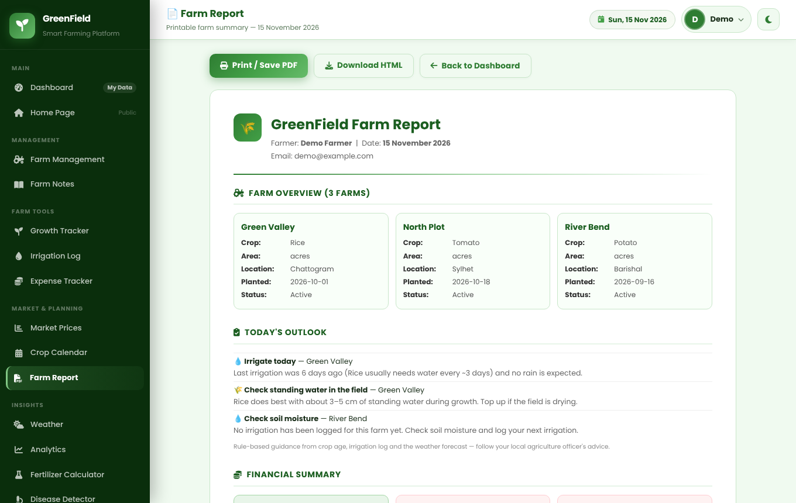
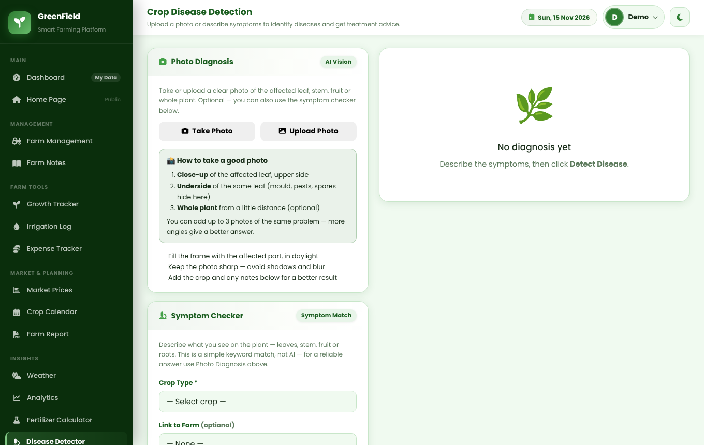
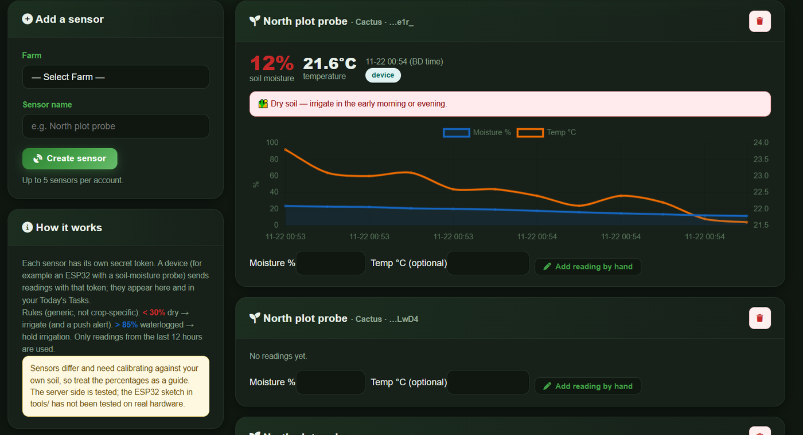
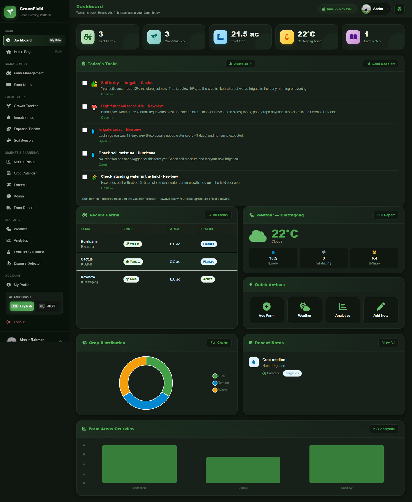

# 🌱 GreenField Smart Farming

A multi-user smart-farming web app for Bangladeshi farmers: farms, crop-aware daily tasks, weather, money tracking, AI leaf-disease hints, push alerts and reports — usable on any phone, even with weak signal.

**Live demo:** https://greenfield-smart-farming-1.onrender.com *(free hosting — first load can take 30–50 s)*
**Code:** https://github.com/abdurrahmancce/greenfield-smart-farming

[](https://github.com/abdurrahmancce/greenfield-smart-farming/actions/workflows/ci.yml)
   

> Screenshots use demo data, not a real farmer's records.

| Dashboard + Today's Tasks | Mobile (installable PWA) |
| --- | --- |
|  |  |

| Expenses & profit/loss | Market prices (record what you saw) |
| --- | --- |
|  |  |

| Farm report (print / PDF / CSV) | Crop disease detector |
| --- | --- |
|  |  |

| Soil sensor (simulated device data) | Sensor reading becomes a task |
| --- | --- |
|  |  |

## 🚀 Features

* **Today's Tasks** — rule-based, crop-aware to-do list (irrigation, top-dressing, harvest window, fungal risk, rain/heat) from general Bangladesh crop guidance plus the OpenWeather forecast. Says so when the forecast is unavailable instead of guessing.
* **Push alerts** — Web Push (VAPID) for rain, heat, fungal risk, harvest approaching/ready, irrigation due / not needed. Sent by a GitHub Actions job every 3 hours, de-duplicated, with a one-tap test alert.
* **Works without signal** — expenses and irrigation entered offline are stored on the phone and synced automatically when the connection returns, with per-entry IDs so nothing is saved twice.
* **AI crop-disease photo check** — Gemini vision, two-model cross-check, multi-photo scans, deliberately humble confidence labels, and a measured accuracy script (`tools/eval_disease.py`).
* **Soil sensors** — each sensor gets its own secret token; a device (or the included simulator, or a hand-typed reading) sends soil moisture/temperature over HTTPS. Readings are charted, drive a "soil is dry — irrigate" task and push alert (and quiet the schedule-based nudge when the soil is fine). The server side is tested; the ESP32 sketch in `tools/` has **not** been run on real hardware.
* **Yield & profit/loss forecast** — plain arithmetic, not ML: area × yield per acre × price − costs, shown as a low / typical / high range with a break-even yield and price. Built-in yield ranges are rough Bangladesh figures that are *not* checked against official statistics, so every farm can enter its own yield, price and remaining costs. The page says plainly that it is an estimate.
* **Money tracking** — income/expense log, per-farm profit & loss, per-acre figures, monthly trend, cost breakdown.
* **Farm tools** — farms with map location, growth tracker, irrigation log, notes, crop calendar, NPK fertilizer calculator, weather, analytics.
* **Market prices you can trust** — labelled reference values plus prices *you* record; trends only when there is enough real data.
* **Reports & export** — printable Farm Report (Bangla OK), English PDF, Excel-safe CSV (expenses / irrigation / farms), full account data export and account deletion.
* **Admin overview** — aggregate numbers only (no personal records), visible only to e-mails in `ADMIN_EMAILS`; anyone else gets a 404.
* **Bangla + English** UI, dark mode, installable PWA, Google sign-in.

## ⚠️ Honest limitations

* The disease detector is an AI guess. Measured with `tools/eval_disease.py` on PlantVillage lab photos (`eval-results.txt`): **64% correct on the 67 photos that got an answer (43/67; 53 more failed because of the free AI quota)**. It was also over-confident: answers shown as 80-100% were right only 71% of the time, 60-79% right 67%, below 60% right 17%. Tomato leaf mold, bacterial spot and Septoria were the weakest. Real field photos will do worse than lab photos, and a repeat run can answer differently - always confirm with a local agriculture officer.
* Market prices are not live: the government source (DAM) publishes daily prices only as downloadable files, so the app shows approximate reference values and the prices users record themselves.
* Task rules are general guidance, not field-specific advice.
* Free hosting sleeps when idle (first load can take ~30-50 s); the keep-alive job reduces this.
* The nightly backup runs, but restoring from it has not been tested yet.
* The server-made PDF report is English-only (Bangla needs a shaping font); the browser's print / save-as-PDF on the Farm Report page handles Bangla. CSV files open correctly in Excel with Bangla text.
* Offline entries (expenses / irrigation) are kept in the phone's browser storage until they sync; clearing the browser's site data before they sync deletes them.

## 🔒 Security

A full audit-and-fix pass is documented in [`SECURITY.md`](SECURITY.md). Highlights:

* Per-user data isolation: every farm/record route checks ownership (no IDOR); inputs validated and clipped server-side; parameterized SQL only.
* CSRF (Origin/Referer) checks, login throttling, hashed one-time reset tokens, sessions invalidated on password change, and Google login only for verified e-mails.
* Strict Content-Security-Policy (scripts only from this site or with a per-request nonce, no inline handlers, libraries self-hosted), magic-byte image checks, push-endpoint allow-list, rate limits on expensive endpoints.
* Account deletion removes all of a user's data; dependency versions pinned to patched releases; secret scanning and push protection enabled on GitHub.
* GitHub Actions run with minimal permissions; `main` is protected against force-push and deletion.
* Secrets live only in environment variables / GitHub secrets — never in the repo.

## 🧪 Testing & automation

* **81 pytest tests** (auth, isolation, validation, offline sync, exports, push rules, admin, CSP, soil sensors, forecast) run on every push via GitHub Actions.
* **Nightly encrypted PostgreSQL backup** (artifact kept 14 days, fails loudly), **keep-alive** and **weather-alert** workflows.
* Run locally: `python -m pytest -q`

## 🛠️ Tech stack

| Area | Technology |
| --- | --- |
| Backend | Python 3.12, Flask 3.1, Gunicorn |
| Database | PostgreSQL (Supabase) in production, SQLite locally |
| Frontend | HTML/CSS, vanilla JavaScript, Chart.js, Leaflet + OpenStreetMap |
| APIs | OpenWeather, Google Gemini (vision), Nominatim |
| Auth | Flask sessions, Werkzeug hashing, Google OAuth (Authlib) |
| Push / PWA | Web Push (pywebpush), service worker, manifest |
| Reports | reportlab (PDF), CSV |
| CI/CD | GitHub Actions, Render |

## 🏗️ Architecture

```text
 Phone / PC ──► Flask (Gunicorn on Render) ──► PostgreSQL (Supabase)
     ▲                 │
     │                 ├─► OpenWeather · Gemini · Nominatim
     │                 └─► Web Push services
 localStorage queue            ▲
 (offline entries)             │
                      GitHub Actions: tests · alerts every 3 h · nightly backup · keep-alive
```

Main modules: `app.py` (routes, DB wrapper), `farm_tasks.py` (task rules), `vision.py` (disease AI), `exports.py` (CSV/PDF), `forecast.py` (yield/profit arithmetic), `tools/sensor_simulator.py` + `tools/esp32_soil_sensor.ino` (sensor demo), `i18n.py` (Bangla), `static/sw.js` + `static/js/offline-sync.js` (PWA/offline), `static/js/ui.js` (CSP-safe click handling), `static/vendor/` (self-hosted Chart.js, Leaflet, Font Awesome).

## ⚙️ Run locally

```bash
git clone https://github.com/abdurrahmancce/greenfield-smart-farming.git
cd greenfield-smart-farming
python -m venv venv
venv\Scripts\activate          # Windows  (Linux/macOS: source venv/bin/activate)
pip install -r requirements.txt
python app.py                   # http://127.0.0.1:5000
```

Optional environment variables (use a `.env` file, never commit it):

| Variable | Purpose |
| --- | --- |
| `SECRET_KEY` | Session signing (required in production) |
| `DATABASE_URL` | PostgreSQL URL (SQLite is used if unset) |
| `OPENWEATHER_KEY` | Live weather |
| `GEMINI_API_KEY` | Disease detector |
| `GOOGLE_CLIENT_ID` / `GOOGLE_CLIENT_SECRET` | Google sign-in |
| `VAPID_PUBLIC_KEY` / `VAPID_PRIVATE_KEY` / `VAPID_SUBJECT` | Push (`tools/gen_vapid.py` makes keys) |
| `CRON_TOKEN` | Protects `/api/cron/alerts` |
| `ADMIN_EMAILS` | Comma-separated admin e-mails |
| `BREVO_API_KEY` + `MAIL_FROM` | Password-reset e-mail over HTTPS (works on Render's free plan, which blocks SMTP) |
| `MAIL_SERVER` / `MAIL_PORT` / `MAIL_USERNAME` / `MAIL_PASSWORD` | Optional SMTP fallback for hosts that allow it |

> **E-mail note:** reset mail is sent through Brevo's HTTPS API with a verified sender. A free-mail sender (e.g. Gmail) works for a demo but may land in spam; for production, use your own domain with DKIM/DMARC set up.
| `APP_BASE_URL` | Public URL for links in e-mail/push |

## 🌐 Deployment

Push to `main` → GitHub Actions runs tests → Render redeploys automatically. Config is in `render.yaml`, `Procfile` and `runtime.txt`.

## 🚧 Future improvements

* Better disease accuracy, validated on real field photos
* Tested restore procedure for the nightly backups
* SMS alerts (needs a paid gateway); Bangla fonts in the server PDF
* Real-hardware test of the soil sensor sketch; sensor calibration per crop
* Check the forecast's yield table against official statistics

## 👨‍💻 Author

**Abdur Rahman** — Computer & Communication Engineering, International Islamic University Chittagong

[GitHub](https://github.com/abdurrahmancce) · [LinkedIn](https://www.linkedin.com/in/abdur-rahman-akash26/) · [Portfolio](https://abdurrahmancce.github.io/Personal-Portfolio/)

## 📄 License & usage

A personal academic and portfolio project. The source is public for viewing and learning; please do not copy, redistribute or use it commercially without the author's permission.
